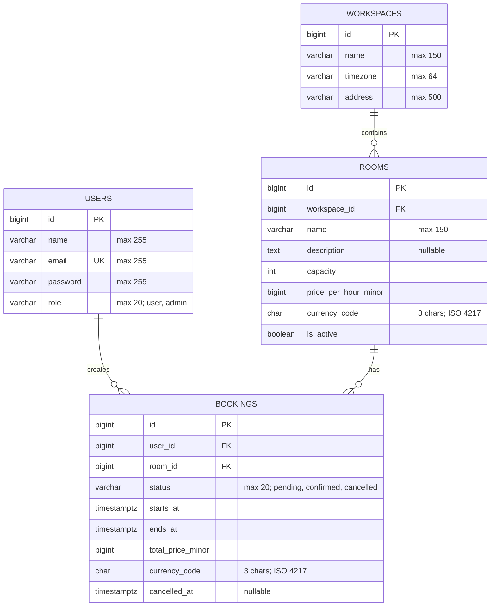

# Coworking Booking API — схема БД v1

## Связи

- `WORKSPACES 1:N ROOMS`
- `ROOMS 1:N BOOKINGS`
- `USERS 1:N BOOKINGS`

## Ограничения

- `users.role`: строковый PHP Enum `user | admin`.
- `bookings.status`: строковый PHP Enum `pending | confirmed | cancelled`.
- `price_per_hour_minor` и `total_price_minor`: `BIGINT`, сумма в минимальных единицах валюты; значение неотрицательное (`CHECK >= 0`).
- `capacity > 0`; `ends_at > starts_at`.
- Для активных бронирований одной комнаты запрещены пересекающиеся интервалы (PostgreSQL exclusion constraint; реализуем в миграции).
